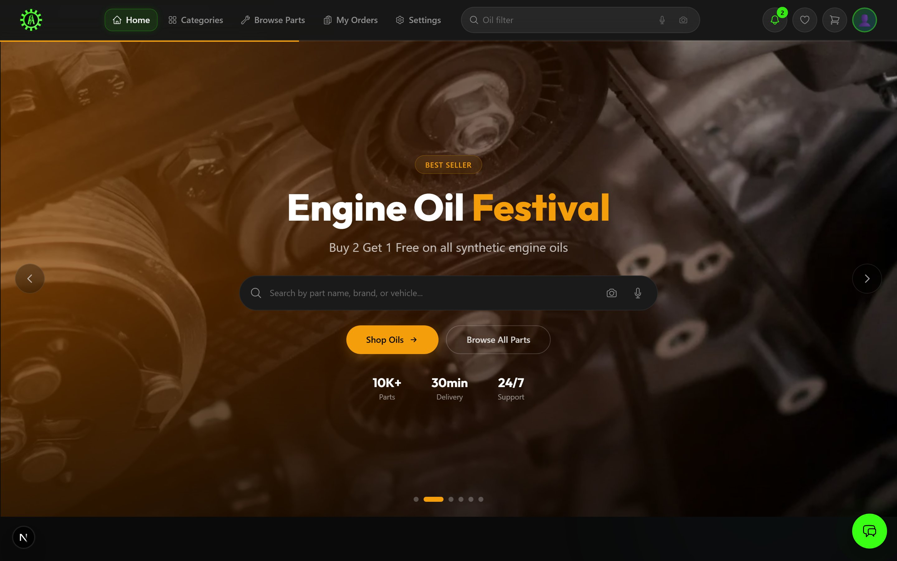
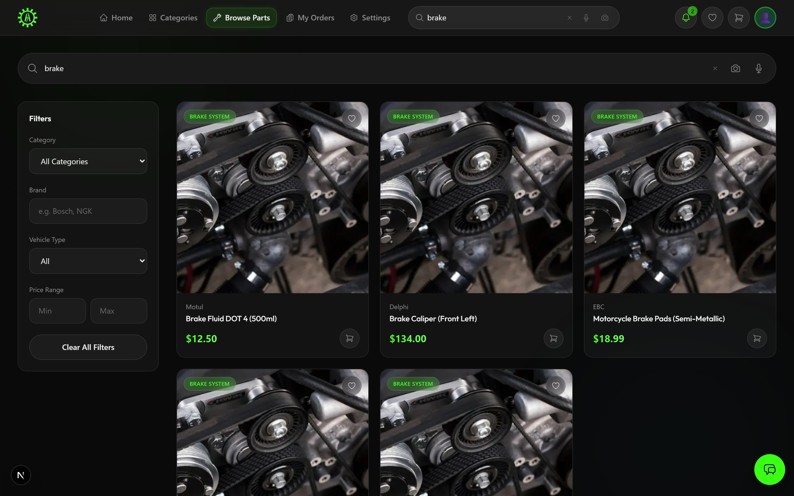
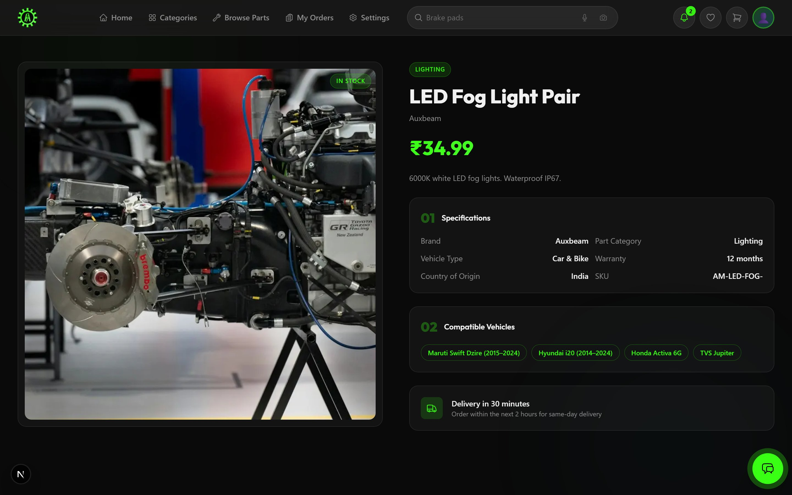
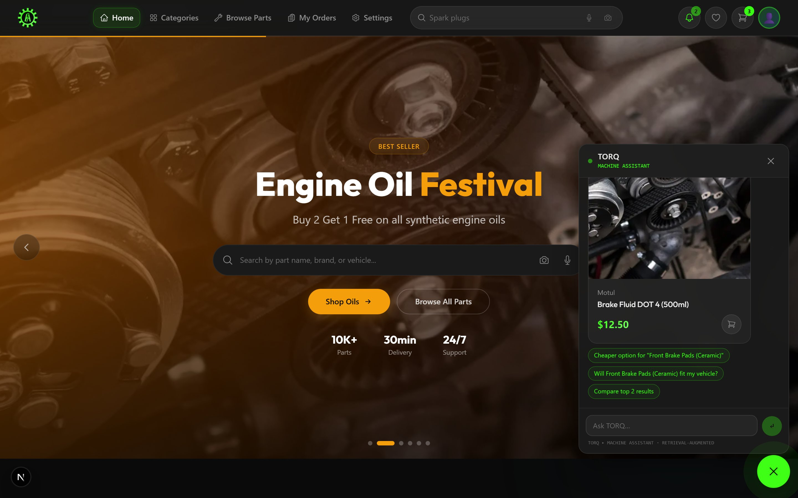
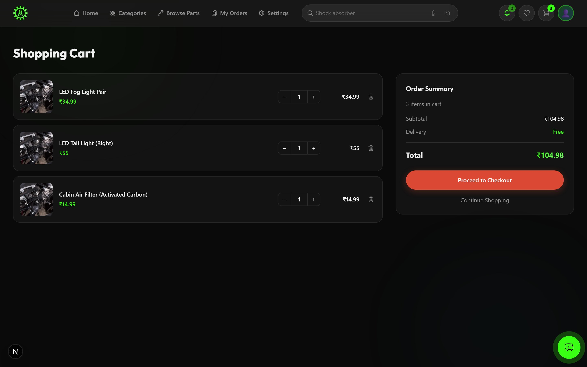
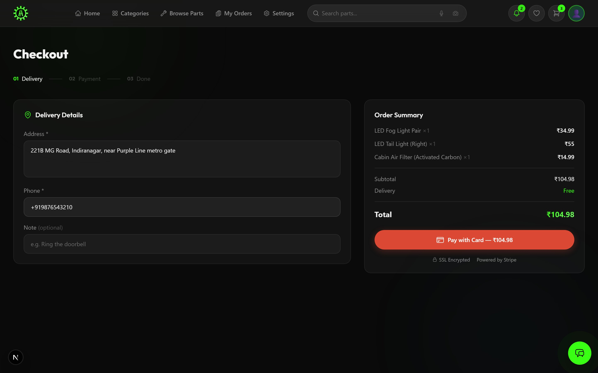
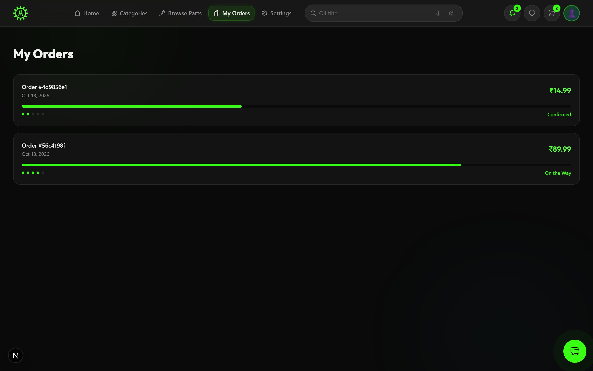
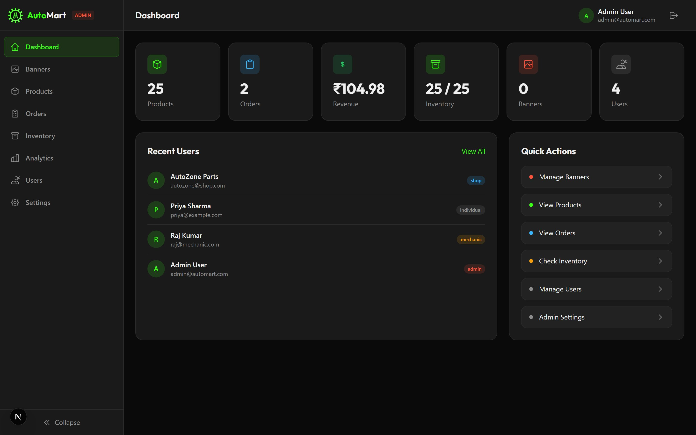

<div align="center">

# AutoMart ⚡🚗

**Auto parts delivery platform — order any car/bike spare part, delivered in 30 minutes.**

A full-stack **microservices monorepo** built for learning. **9 backend services + a Next.js frontend**, featuring fuzzy/Trie search, image & voice search, Stripe payments, a full admin panel, and a **retrieval-augmented (RAG) AI assistant**.

[](https://github.com/SanjaykannaR/AutoMart/actions/workflows/ci.yml)
[](https://github.com/SanjaykannaR/AutoMart/actions/workflows/e2e.yml)
[](https://nodejs.org)
[](https://www.typescriptlang.org)
[](https://nextjs.org)
[](#license)

[Live Frontend](https://auto-mart-web.vercel.app) · [Live API](https://automart-backend-f1ic.onrender.com/health) · [Screenshots](#-screenshots)

</div>

---

## 📸 Screenshots

> Captured from the running application (desktop, 1440px). Dark glassmorphism UI, animated with Framer Motion.

<table>
  <tr>
    <td width="50%" valign="top">
      
      <sub><b>Home</b> — admin-managed hero carousel, instant search (voice + image), live stats</sub>
    </td>
    <td width="50%" valign="top">
      
      <sub><b>Search</b> — fuzzy text search, category/brand/vehicle/price filters, wishlist + quick-add</sub>
    </td>
  </tr>
  <tr>
    <td width="50%" valign="top">
      
      <sub><b>Product detail</b> — specs table, compatible-vehicle fitment, stock badge, 30-min delivery</sub>
    </td>
    <td width="50%" valign="top">
      
      <sub><b>TORQ assistant</b> — RAG chatbot streaming a retrieved product card + follow-up chips</sub>
    </td>
  </tr>
  <tr>
    <td width="50%" valign="top">
      
      <sub><b>Cart</b> — quantity controls, order summary, localStorage + backend sync</sub>
    </td>
    <td width="50%" valign="top">
      
      <sub><b>Checkout</b> — 3-step flow, address/phone validation, Stripe Checkout (SSL)</sub>
    </td>
  </tr>
  <tr>
    <td width="50%" valign="top">
      
      <sub><b>Orders</b> — status progress tracker (pending → confirmed → picked → shipped → delivered)</sub>
    </td>
    <td width="50%" valign="top">
      
      <sub><b>Admin dashboard</b> — revenue/orders/inventory stats, recent users, quick actions</sub>
    </td>
  </tr>
</table>

---

## 🧭 Overview

AutoMart is an e-commerce platform for car and bike spare parts with an obsession on **speed** (30-minute delivery) and **findability** (you must be able to find the right part by typing, speaking, or uploading a photo).

It is intentionally built as a **learning project** that goes deep on the things that matter in production systems:

- **Microservices + API Gateway** with database-per-service and event-driven communication.
- **Real data-structure & algorithm work** — a hand-written Trie, TF-IDF, Bitap/Levenshtein fuzzy matching, and cosine vector similarity.
- **A RAG pipeline** — hybrid lexical + semantic retrieval fused with Reciprocal Rank Fusion, streamed to a chat widget over SSE.
- **Serious security hygiene** — layered rate limiting, bot defense, fail-closed JWT, admin-only write gates.
- **Full delivery lifecycle** — cart → checkout → Stripe → order state machine → live tracking → notifications.

---

## 🧰 Tech Stack

| Layer | Technology |
|---|---|
| **Frontend** | Next.js 15 (App Router), React 19, Tailwind CSS 4, Framer Motion |
| **Backend** | Node.js 20, Express, TypeScript (all 9 services) |
| **Database** | PostgreSQL (Supabase) — one DB, Prisma ORM per service |
| **Cache / Events** | Redis 7 (Upstash) — pub/sub bus, OTP storage, rate-limit backing |
| **Search / AI** | Fuse.js (Bitap), custom Trie, TF-IDF, CLIP image embeddings, MiniLM pgvector RAG |
| **Payments** | Stripe Checkout + webhooks |
| **Auth** | JWT + bcrypt, Google OAuth, phone OTP, Cloudflare Turnstile |
| **Email** | Resend / SMTP via Nodemailer |
| **Testing** | Vitest (unit), Playwright E2E (Page Object Model) |
| **CI/CD** | GitHub Actions, Vercel (web) + Render (API) |
| **DevOps** | Docker + Docker Compose, multi-stage builds |

---

## 🏗️ Architecture

```
                         ┌──────────────────────────────┐
                         │        Next.js 15 (RSC)      │
                         │   React 19 · Tailwind 4      │
                         │   Dark Glassmorphism UI      │
                         └──────────────┬───────────────┘
                                        │  HTTPS
                         ┌──────────────▼───────────────┐
                         │         API Gateway :3000    │
                         │  CORS · Helmet · JWT auth    │
                         │  Rate limiting · Turnstile   │
                         │  (http-proxy-middleware)     │
                         └──────────────┬───────────────┘
        ┌───────────────┬───────────────┼───────────────┬───────────────┐
        ▼               ▼               ▼               ▼               ▼
 ┌─────────────┐ ┌─────────────┐ ┌─────────────┐ ┌─────────────┐ ┌─────────────┐
 │ Auth   3001 │ │ Product 3002│ │ Search  3003│ │ Order   3004│ │Inventory3005│
 │ JWT·OAuth·  │ │ CRUD·       │ │ Fuse.js·    │ │ State       │ │ Reserve·    │
 │ OTP·Banners │ │ Categories  │ │ Trie·CLIP   │ │ machine·    │ │ Release·    │
 │ Cart/Wish   │ │             │ │ Voice       │ │ Stripe      │ │ Confirm     │
 └──────┬──────┘ └─────────────┘ └─────────────┘ └──────┬──────┘ └──────┬──────┘
        │                                               │               │
        │              ┌─────────────────┐              └───────┬───────┘
        │              │ Notification3006│ ◄───── Redis Pub/Sub ┘
        │              │ Email/SMS (Resend)│   order:created · user:otp …
        │              └─────────────────┘
        │
        ├───────────────┬──────────────────────────────────────┐
        ▼               ▼                                      ▼
 ┌─────────────┐ ┌──────────────┐                    ┌──────────────────┐
 │  MCP   3007 │ │ Assistant3008│ ── pgvector ──►    │  Supabase        │
 │ 5 AI tools  │ │ RAG chatbot  │   (semantic kNN)   │  Postgres +      │
 │ (Claude/    │ │ hybrid+RRF   │ ◄─ MiniLM embed    │  pgvector        │
 │  Cursor)    │ │ SSE stream   │                    └──────────────────┘
 └─────────────┘ └──────────────┘
```

**Patterns demonstrated:** API Gateway · database-per-service · event-driven (Redis Pub/Sub) · monorepo (npm workspaces) · containerization · CI/CD.

---

## 📦 Services

| Service | Port | Responsibility | Key capabilities |
|---|---|---|---|
| **API Gateway** | 3000 | Single entry point | Routing, JWT verification, admin-only write gates, 3 tiers of rate limiting, Turnstile bot defense, CORS, Helmet |
| **Auth** | 3001 | Identity & profile | Register/login, Google OAuth, phone OTP verify, forgot/reset password, admin bootstrap & user management, banners CRUD, cart/wishlist persistence |
| **Product** | 3002 | Catalog | Product CRUD, categories, slug lookup, filtering (category/brand/price/vehicle), stats |
| **Search** | 3003 | Discovery | Fuzzy search (Fuse.js/Bitap), Trie autocomplete, TF-IDF scoring, CLIP image search, voice transcription |
| **Order** | 3004 | Order lifecycle | Create/list/detail, **status state machine**, stats/analytics, **Stripe** checkout + webhooks |
| **Inventory** | 3005 | Stock | Reserve / release / confirm, event-driven sync |
| **Notification** | 3006 | Comms | Email (Resend/SMTP) driven by Redis pub/sub events |
| **MCP Server** | 3007 | AI integration | Exposes 5 tools to Claude Desktop / Cursor via Model Context Protocol (HTTP + stdio) |
| **Assistant** | 3008 | RAG assistant | Hybrid retrieval (lexical ⊕ semantic) + RRF + LLM → SSE-streamed answers with product cards |

---

## 🔍 Search — three modes, real algorithms

### 1. Fuzzy text search (Fuse.js / Bitap)
Typo-tolerant matching using the **Bitap algorithm** (a modified **Levenshtein distance**). `brake pads`, `break pads`, and `barking bad` all converge on *brake pads*. Results are phonetically normalized before matching.

### 2. Autocomplete — a hand-written **Trie**
A custom `Trie` (`services/search-service/src/search/trie.ts`) powers the instant suggestions as you type, with `insert`, `search`, `remove`, and `insertPhrase`. Backed by **10/10 passing unit tests**. Falls back to Fuse.js for mid-word queries the Trie can't prefix-match.

### 3. Image & voice search
- **Image:** upload a part photo → **CLIP** embeddings → **cosine similarity** against the catalog vector index (`imageSearch.ts`). Gated behind `ENABLE_IMAGE_SEARCH` to avoid loading the ~350MB model by default.
- **Voice:** browser-native **Web Speech API** — zero backend cost.

> **Note:** image search uses `@huggingface/transformers` (migrated from `@xenova/transformers` to clear a critical CVE).

### DSA implemented
| Algorithm | Where | Purpose |
|---|---|---|
| **Trie** | `search/trie.ts` | Prefix autocomplete suggestions |
| **Bitap / Levenshtein** | Fuse.js | Typo-tolerant fuzzy matching |
| **TF-IDF** | `search/tfidf.ts` | Term-frequency relevance scoring |
| **Cosine similarity** | `search/vectorIndex.ts` | Vector comparison for image/semantic search |
| **Reciprocal Rank Fusion** | `assistant/retrieval.ts` | Merge lexical + semantic result lists |

---

## 🤖 TORQ — the RAG assistant

A **retrieval-augmented generation** chatbot with a fast, factual, "machine" persona, streamed to a FAB/drawer widget.

```
User message
   │
   ▼
1. Intent / entity parse   (price ceiling, vehicle type)
   │
   ├─► LEXICAL   search-service /search  (Fuse.js + TF-IDF)
   ├─► SEMANTIC  MiniLM query embed → pgvector cosine kNN
   │
2. Reciprocal Rank Fusion (RRF)  →  score(d) = Σ 1/(k + rank)
   │
3. Token-overlap boost + top-N enrich from the live catalog
   │
4. LLM adapter — LLM_PROVIDER = template | gemini | groq
   │
5. SSE stream → status → text deltas → product rail → chips → done
```

- **Zero-cost by default:** local MiniLM embeddings (384-dim) + `template` provider (retrieval-only, no API key). Swap to `gemini`/`groq` via env with no code change.
- **Semantic index:** a background worker re-embeds products into pgvector every 5 minutes (idempotent, skips unchanged rows).
- **Graceful degradation:** search-service down → semantic-only; pgvector down → lexical-only; both down → empty (never throws).

---

## 🔐 Security

- **Layered rate limiting:** global (1000/15min) → auth (200/15min) → OTP (5/15min) to stop volume attacks, brute force, and SMS bombing.
- **Cloudflare Turnstile** bot defense on login/register/OTP/admin-login (auto-skips when unconfigured).
- **Fail-closed JWT:** the auth service refuses to start without `JWT_SECRET` — no more public `dev-secret` fallback.
- **Admin-only write gates:** the gateway blocks non-admin `POST/PUT/PATCH/DELETE` on `/products`, `/categories`, `/inventory`, and `PATCH /orders/:id/status`; order-service re-checks the role server-side (defense in depth).
- **Helmet** security headers + strict **CORS** allowlist.
- **Structured errors** everywhere: `{ code, message, hint }` — validation (400), auth (401), not-found (404), conflict (409), rate-limit (429), server (500).

---

## 🚀 Getting Started

### Prerequisites
- **Node.js 20+** (`node -v`) and **npm 10+**
- **Docker & Docker Compose** (optional, for the full stack)

### Option A — Local dev (frontend only + live API)
```bash
git clone https://github.com/SanjaykannaR/AutoMart.git
cd AutoMart
npm install

# Point the frontend at the deployed API (or your own gateway)
# apps/web reads NEXT_PUBLIC_API_URL at build/dev time
npm run dev:web          # → http://localhost:3000
```

### Option B — Full stack with Docker (recommended)
```bash
cp .env.docker.example .env.docker      # then fill in secrets
docker compose up --build
# Frontend   → http://localhost:3080
# API Gateway→ http://localhost:3000
```

### Option C — Run each service individually
```bash
# 1. Set up databases (Postgres) + seed
npx prisma migrate dev --schema=services/auth-service/prisma/schema.prisma
npx prisma migrate dev --schema=services/product-service/prisma/schema.prisma
npx prisma migrate dev --schema=services/order-service/prisma/schema.prisma
npx prisma migrate dev --schema=services/inventory-service/prisma/schema.prisma
node services/auth-service/prisma/seed.js
node services/product-service/prisma/seed.js

# 2. Start services (each in its own terminal)
npm run dev:gateway        # :3000
npm run dev:auth           # :3001
npm run dev:products       # :3002
npm run dev:search         # :3003
npm run dev:orders         # :3004
npm run dev:inventory      # :3005
npm run dev:notifications  # :3006
npm run dev:mcp            # :3007
npm run dev:assistant      # :3008
npm run dev:web            # frontend
```

---

## 🔑 Test Accounts

After seeding:

| Name | Email | Password | Role |
|---|---|---|---|
| Admin User | `admin@automart.com` | `AutoMart@2026!` | admin |
| Priya Sharma | `priya@example.com` | `Password123!` | individual |
| Raj Kumar | `raj@mechanic.com` | `Password123!` | mechanic |
| AutoZone Parts | `autozone@shop.com` | `Password123!` | shop |

Admin panel: `/admin/login`.

---

## 🌐 API Endpoints

All routes go through the gateway (`/api/...`). Errors are always `{ code, message, hint }`.

### Auth (`/api/auth`)
| Method | Endpoint | Auth | Description |
|---|---|---|---|
| POST | `/register` | No | Create account (name, email, password, role) |
| POST | `/login` | No | Login → JWT |
| POST | `/oauth` | No | Google / Apple sign-in |
| POST | `/otp/send` `/otp/verify` | — | Phone verification |
| POST | `/password/forgot` `/password/reset` | — | Password reset |
| GET | `/me` | JWT | Current user profile |
| GET/PUT | `/users/me/cart` `/users/me/wishlist` | JWT | Persist cart & wishlist |
| * | `/admin/*` | Admin | Users, analytics, banners management |

### Products (`/api/products`)
| Method | Endpoint | Auth | Description |
|---|---|---|---|
| GET | `/products` | No | List (filters: category, brand, minPrice, maxPrice, vehicleType, search) |
| GET | `/products/:id` `/products/slug/:slug` | No | Detail |
| POST/PATCH/DELETE | `/products…` | Admin | Mutations |
| GET | `/categories` | No | Categories with counts |

### Search (`/api/search`)
| Method | Endpoint | Auth | Description |
|---|---|---|---|
| GET | `/search?q=…` | No | Fuzzy search (+ filters) |
| GET | `/autocomplete?q=…` | No | Trie suggestions |
| POST | `/search/image` | No | Image search (multipart) |

### Orders (`/api/orders`) — JWT
| Method | Endpoint | Description |
|---|---|---|
| POST | `/orders` | Create order (items, address, phone, total) |
| GET | `/orders` `/orders/:id` | List / detail |
| PATCH | `/orders/:id/status` | **Admin** — state machine |
| GET | `/orders/stats` `/orders/analytics` | **Admin** — metrics |

### Payments (`/api/payments`)
| Method | Endpoint | Description |
|---|---|---|
| POST | `/create-checkout` | Create Stripe Checkout session |
| POST | `/webhook` | Stripe webhook (marks orders paid) |

### Assistant (`/api/assistant`)
| Method | Endpoint | Description |
|---|---|---|
| POST | `/chat` | SSE stream: `status → text → products → chips → done` |
| GET | `/health` | Health + index size |
| POST | `/reindex` | Manual re-embed trigger |

---

## 🧩 MCP Tools (AI agent integration)

The MCP server exposes AutoMart to **Claude Desktop / Cursor** over the Model Context Protocol:

| Tool | Description | Parameters |
|---|---|---|
| `search_parts` | Search parts by text | `query`, `category?`, `maxPrice?`, `limit?` |
| `check_stock` | Real-time stock availability | `productId` |
| `get_order_status` | Order status + tracking | `orderId` |
| `get_categories` | List categories | — |
| `get_popular_parts` | Popular parts | `limit?` |

---

## 🗂️ Project Structure

```
automart/
├── apps/web/                          # Next.js 15 frontend
│   └── src/
│       ├── app/                       # App Router pages
│       │   ├── page.tsx               # Landing (hero + categories)
│       │   ├── search/ products/[id]/ cart/ checkout/ orders/
│       │   ├── admin/                 # Full admin panel (dashboard, analytics,
│       │   │                          #   products, inventory, orders, users, banners, settings)
│       │   └── auth/                  # profile-setup, verify-phone
│       └── components/                # Toast, ThemeToggle, ErrorBoundary,
│                                      #   SearchBar, ProductCard, GlassCard, chat/
├── services/
│   ├── api-gateway/                   # Routing + auth + rate limiting + Turnstile
│   ├── auth-service/                  # JWT, OAuth, OTP, banners, cart/wishlist
│   ├── product-service/               # Catalog + categories
│   ├── search-service/                # Trie + Fuse.js + TF-IDF + CLIP + voice
│   │   └── src/search/                #   trie.ts · textSearch.ts · imageSearch.ts
│   │                                  #   vectorIndex.ts · tfidf.ts (+ unit tests)
│   ├── order-service/                 # Orders + Stripe + state machine
│   ├── inventory-service/             # Stock reserve/release/confirm
│   ├── notification-service/          # Email via Redis pub/sub
│   ├── assistant-service/             # RAG: embedding · pgvector · retrieval · llm
│   └── mcp-server/                    # MCP tools (HTTP + stdio)
├── e2e/                               # Playwright E2E (Page Object Model)
│   ├── pages/                         #   6 page objects
│   └── tests/                         #   auth · product · order · admin · ui
├── supabase/                          # SQL migrations (pgvector, storage buckets)
├── docs/screenshots/                  # README screenshots
├── docker-compose.yml                 # Full stack
├── Dockerfile.prod                    # Multi-stage prod build (Render)
├── render.yaml · vercel.json          # Deploy config
└── .github/workflows/                 # ci.yml · e2e.yml · build.yml · keep-warm.yml
```

---

## ✅ Testing

- **Unit (Vitest):** Trie (10/10), TF-IDF, vector index, voice normalization.
- **E2E (Playwright):** **17 spec files** with a **Page Object Model** (6 page objects) covering auth, product browse/search, order placement/tracking, the full admin panel, and UI (account, categories, wishlist). Runs cross-browser (Chromium/Firefox/WebKit) in CI against the deployed environment.
- **Coverage of flows:** register → login → search → add to cart → checkout → track order → admin manage.

---

## 🔁 CI/CD

GitHub Actions workflows:
- **`ci.yml`** — parallel TypeScript build matrix across all backend services (`tsc --noEmit`), unit tests, and a frontend `next build`.
- **`e2e.yml`** — Playwright E2E on `deployment_status`, cross-browser matrix, uploads report on failure.
- **`build.yml`** — Docker image builds.
- **`keep-warm.yml`** — pings the Render free-tier backend every 10 min to prevent cold starts.

**Deploy:** frontend on **Vercel** (`apps/web`), backend on **Render** as a single Docker container running all services (`Dockerfile.prod` + `scripts/start-prod.sh`).

---

## 🐳 Deployment Architecture

```
GitHub (main)
   ├── 🌐 Frontend → Vercel   https://auto-mart-web.vercel.app
   │     Next.js 15 (apps/web), configured via vercel.json "services" schema
   │
   └── 🖥️ Backend  → Render    https://automart-backend-f1ic.onrender.com
         Single Docker container: gateway (:3000, primary port) + all 8 services
         (:3001–:3008) started by scripts/start-prod.sh
         Supabase (Postgres + pgvector) · Upstash (Redis) · Stripe · Resend
```

See [DEPLOYMENT.md](DEPLOYMENT.md) for the full step-by-step guide (env vars, Turnstile, Stripe webhooks, Google OAuth origins, troubleshooting).

---

## 📈 Learning Outcomes

This project demonstrates end-to-end competence across the stack:

- **Microservices architecture** with database-per-service and an API Gateway.
- **Event-driven design** via Redis Pub/Sub (order → inventory + notification).
- **Monorepo management** with npm workspaces.
- **Containerization** with multi-stage Docker builds + Compose.
- **CI/CD** with GitHub Actions (build matrix, E2E, keep-warm).
- **E2E testing** with Playwright + the Page Object Model.
- **Data structures & algorithms** — Trie, Levenshtein/Bitap, TF-IDF, cosine similarity, RRF.
- **AI integration** — RAG (hybrid retrieval + pgvector + LLM), CLIP image search, and MCP for agent tooling.
- **Payments & security** — Stripe Checkout/webhooks, JWT + bcrypt, layered rate limiting, bot defense, admin RBAC.
- **Structured error handling** and observability across every service.

---

## 🧹 Regenerating the Screenshots

The screenshots in `docs/screenshots/` are produced by a Playwright script that drives the running app:

```bash
# Start the stack (Docker or individual services), then:
node scripts/capture-screenshots.mjs
# Point at a different target with env vars:
BASE_URL=http://localhost:3080 API_URL=http://localhost:3000 node scripts/capture-screenshots.mjs
```

It logs in (seeded accounts), seeds demo cart/orders, and captures the 8 key pages as 1440×900 JPEGs.

---

## 📄 License

MIT
